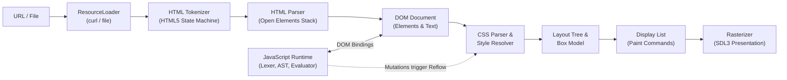

# Educational Browser Engine

An educational browser engine built completely from scratch in modern C++20 on Linux (Fedora). This project demystifies and implements the core internal mechanisms behind production browser engines like Chromium (Blink) and WebKit—including HTML5 tokenization and parsing, DOM tree construction, CSS parsing and style cascading, normal flow block layout, retained display lists, 2D rasterization, an educational JavaScript interpreter, DOM host bindings, and HTTP/HTTPS networking.

> [!IMPORTANT]
> **Pure Educational Implementation**: This engine does not use or wrap WebView, Chromium Embedded Framework (CEF), Electron, or WebKit to perform layout or rendering. All stages of the pipeline—from lexical scanning to box dimensioning and bytecode/AST interpretation—are implemented directly in modern C++20.

---

## Processing Pipeline



---

## Features & Supported Standards

### 1. HTML Parsing & DOM
- **HTML5 State-Machine Tokenizer**: Handles doctype declarations, start/end tags, self-closing/void tags (``, `<br>`, `<meta>`, `<link>`), unquoted and quoted attribute values, comments, and named/numeric character references (`&amp;`, `&lt;`, `&#60;`, `&#x3C;`).
- **DOM Hierarchy**: Robust node tree (`Document`, `Element`, `TextNode`, `CommentNode`) with RAII ownership semantics.
- **Tree Recovery**: Automatic recovery for implicit `<html>`, `<head>`, `<body>`, and auto-closing `<p>` tags.
- **Node Operations**: `appendChild`, `removeChild`, `insertBefore`, `setTextContent`, `getElementById`, and `getElementsByTagName`.

### 2. CSS & Style Computation
- **CSS Tokenizer & Parser**: Parses rulesets, complex comma-separated selector lists, declarations, and property values.
- **Selector Engine**: Matches element type, `.class`, `#id`, descendant combinators (` `), and direct child combinators (`>`).
- **Cascade & Specificity**: Computes 3-tuple specificities `(ID, Class, Type)`, orders rules by origin (User-Agent vs Author vs Inline `style=""`), and handles property inheritance (`color`, `font-size`, `font-weight`, `font-family`, `text-align`).
- **Box Properties**: Resolves `display` (`block`, `inline`, `none`), colors, borders, margins, padding, widths, heights, and shorthand properties.

### 3. Layout Engine & Box Model
- **Layout Tree Builder**: Generates render boxes while skipping `display: none` and inserting anonymous block containers.
- **Block Formatting**: Derived geometry based on viewport dimensions and containing blocks.
- **Auto Margins**: Centering support (`margin: 0 auto`).
- **Box Dimensions**: Content rect, padding box, border box, and margin box calculations.

### 4. Retained Display List & Graphics
- **Display List**: Retained vector of rendering commands (`FillRect`, `StrokeRect`, `TextItem`, `PushClip`, `PopClip`) decoupled from native drawing backends.
- **Text Rasterization**: Font metrics, glyph measurement, and box clipping.
- **Viewport Clipping & Scrolling**: Mouse wheel scrolling with visual scrollbar rendering.
- **Hit Testing**: Cursor hit testing against the layout tree to detect hovered and clicked elements.

### 5. Educational JavaScript Runtime
- **Lexer & Pratt Parser**: Lexical analyzer and recursive-descent parser for variables, arithmetic, comparisons, logical operators, unary operators, function declarations, `return`, `if/else`, `while`, and `for` loops.
- **Dynamic Values**: `Value` variant supporting `Undefined`, `Null`, `Boolean`, `Number` (double), `String`, `Object`, `Array`, and `Function`.
- **Lexical Scopes & Closures**: Scoped `Environment` chains supporting first-class functions and closures.
- **Safety Limits**: Configurable instruction step limit (50,000 steps) and call recursion depth limit (256 calls) preventing infinite loops and stack exhaustion.

### 6. DOM Bindings & Dynamic Reflow
- **Global APIs**: `console.log`, `window`, and `document`.
- **Node & Element Bindings**: `getElementById`, `getElementsByTagName`, `createElement`, `createTextNode`, `appendChild`, `removeChild`, `getAttribute`, `setAttribute`, `hasAttribute`, `removeAttribute`, `setTextContent`, and `setInnerHTML`.
- **Event Dispatching**: `addEventListener('click', handler)` supporting event bubbling up the DOM tree.
- **Interactive Reflow**: When JavaScript modifies the DOM, the engine automatically re-resolves styles, recalculates layout, and triggers immediate visual updates.

### 7. Networking & Resources
- **URL Resolution**: Full `Url` parser for `file://`, `http://`, `https://`, and `about:` schemes, with relative URL resolution.
- **Resource Loader**: Synchronous fetching backend powered by `libcurl` with TLS verification and local filesystem fallback.
- **External Stylesheets & Scripts**: Automatically downloads and applies `<link rel="stylesheet">` and executes `<script src="...">`.

---

## Project Structure

```
browser-engine/
  ├── include/browser/
  │   ├── core/         # Types (Point, Rect, Color), BrowserDiagnostics, ScopedTimer
  │   ├── platform/     # Window abstractions, SDL3 native integration, input events
  │   ├── events/       # EventDispatcher and decoupled subscription mechanics
  │   ├── shell/        # BrowserEngine coordinator, FrameScheduler
  │   ├── html/         # HtmlTokenizer, HtmlParser, token types
  │   ├── dom/          # Document, Node, Element, TextNode, CommentNode
  │   ├── css/          # CssTokenizer, CssParser, StyleSheet, rules, declarations
  │   ├── style/        # SelectorMatcher, StyleResolver, ComputedStyle
  │   ├── layout/       # Dimensions, LayoutBox, LayoutTreeBuilder, LayoutEngine
  │   ├── graphics/     # DisplayItem, DisplayList, DisplayListBuilder, Rasterizer
  │   ├── networking/   # Url, Resource, ResourceLoader (curl / local)
  │   └── javascript/   # Lexer, Parser, AST, Value, Environment, Interpreter, DomBindings
  ├── src/              # Subsystem implementation files
  ├── tests/            # Unit test suite and test runner
  ├── benchmarks/       # Pipeline throughput benchmark suite
  ├── examples/         # Sample showcase HTML, CSS, and JS files
  │   ├── basic/        # Basic HTML and inline styles
  │   ├── css/          # External stylesheet, cards, auto-margin centering
  │   ├── scripts/      # Interactive counter and button click DOM mutations
  │   └── images/       # Visual image and media placeholders
  └── docs/             # Technical specifications and documentation
```

---

## Building and Running

### Prerequisites

- **C++ Compiler**: GCC 14+ or Clang 18+ with full C++20 support.
- **Build System**: CMake 3.25+ and `make` or `ninja`.
- **Libraries**: SDL3 (`libSDL3`) and libcurl (`libcurl`).

### 1. Build the Project

```bash
# Configure and build in release mode
cmake -B build -S . -DCMAKE_BUILD_TYPE=Release
cmake --build build -j$(nproc)
```

This generates three binaries in `./build/`:
- `browser_shell`: The desktop browser and inspection tool.
- `browser_tests`: Comprehensive unit test runner (51 test cases).
- `browser_benchmarks`: Pipeline throughput benchmark suite.

### 2. Run the Unit Test Suite

```bash
./build/browser_tests
```

Output:
```
====================================================
                RUNNING BROWSER UNIT TESTS           
====================================================
  PASSED: Diagnostics: Counters can be incremented and retrieved
  ...
  PASSED: JavaScript: Lexer tokenizes identifiers, literals, and comments
  PASSED: JavaScript: Arithmetic and operator precedence
  PASSED: JavaScript: Control flow (for and while loops)
  PASSED: JavaScript: Function declarations, returns, and closures
  PASSED: JavaScript: Infinite loop safety via execution step limits
  PASSED: DOM Bindings: getElementById and getElementsByTagName in JS
  PASSED: DOM Bindings: JS mutations (setTextContent, setAttribute, appendChild)
  PASSED: DOM Bindings: addEventListener and event dispatching
====================================================
Test Summary: 51/51 test cases passed (291 assertions passed, 0 failed)
====================================================
```

### 3. Run Benchmarks

```bash
./build/browser_benchmarks
```

Sample Benchmark Results:
```
========================================================================================
                           BROWSER ENGINE BENCHMARK SUITE                               
========================================================================================
Benchmark Name                          Iters     Total (ms)       Avg (us)        Ops/sec
----------------------------------------------------------------------------------------
HTML Tokenize & Parse                    2000        482.436         241.22           4146
CSS Tokenize & Parse                     5000        754.359         150.87           6628
Style Resolution & Cascade               2000        335.670         167.83           5958
Layout Tree & Box Model                  5000        144.786          28.96          34534
JavaScript Lex/Parse/Eval                2000        796.785         398.39           2510
Full Pipeline (HTML->Paint)              1000        875.879         875.88           1142
========================================================================================
```

### 4. Interactive Browser & Developer CLI Tools

#### Run the Interactive Desktop Browser
```bash
# Launch interactive browser opening the JavaScript demo
./build/browser_shell examples/scripts/index.html

# Open the CSS box-model showcase
./build/browser_shell examples/css/index.html

# Run headlessly for 60 frames (ideal for CI)
./build/browser_shell examples/basic/index.html --headless --frames 60
```

#### Command-Line Inspection Flags

```bash
# Tokenize HTML and dump token stream
./build/browser_shell --dump-tokens examples/basic/index.html

# Parse HTML and print ASCII DOM tree
./build/browser_shell --dump-dom examples/basic/index.html

# Parse CSS and inspect computed styles
./build/browser_shell --dump-style examples/css/index.html

# Calculate and dump layout geometry tree
./build/browser_shell --dump-layout examples/css/index.html

# Build and dump retained display list paint commands
./build/browser_shell --dump-display-list examples/css/index.html

# Evaluate arbitrary JavaScript snippet
./build/browser_shell --eval-js "let a = 15; let b = 27; a + b;"
```

---

## Production Hosting & Web Workbench (`browser_server`)

To host the browser engine on a cloud server or local network so others can interact with it over the web:

### Quickstart with Docker Compose

```bash
docker compose up -d --build
```
Open **`http://localhost:8080`** in your browser.

### Native Server Launch

```bash
# Start server on default port 8080
./build/browser_server --port 8080 --bind 0.0.0.0

# Or with custom viewport geometry
./build/browser_server --port 8080 --width 1280 --height 800
```

### Features of the Web Workbench

1. **Interactive Viewport**: Live Retina-sharp vector rendering of the engine's paint display list. Click links or interactive JavaScript buttons directly on the canvas to trigger engine reflows and script callbacks.
2. **Preset Navigation Bar**: One-click shortcuts for demo suites (`about:blank`, CSS rounded cards, JS counter, basic layout).
3. **Live HTML Editor**: Enter arbitrary HTML/CSS directly to immediately view engine rendering and layout.
4. **Developer Tools & Deep Inspection**:
   - **DOM Tree**: Interactive hierarchical node inspector with attributes and text nodes.
   - **Computed Styles**: Exact CSS computed properties (colors, margins, padding, border-radius).
   - **Layout Geometry**: Block box tree with content dimensions and margin/padding boxes.
   - **Display List**: Table of emitted paint operations.
   - **JavaScript REPL**: Interactive console to evaluate JavaScript expressions against the active page.
   - **Telemetry & Diagnostics**: Live subsystem latency charts with microsecond precision.
5. **RESTful Automation API**:
   - `GET /health`: Health-check endpoint for orchestrators and load balancers.
   - `POST /api/navigate`: Programmatically navigate to URLs or load HTML snippets.
   - `POST /api/click`: Simulate clicks at viewport coordinates `(x, y)`.
   - `POST /api/eval`: Evaluate JavaScript snippets and receive DOM state.
   - `GET /api/diagnostics`: Subsystem timing telemetry.

For reverse proxy configuration (Nginx/Caddy with SSL) and systemd services, see [docs/production-hosting.md](file:///home/habrmnc/habrmnc/browser-engine/docs/production-hosting.md).

---

## Interactive Controls (Native Desktop Shell)

- **Left Mouse Click**: Click navigation buttons (`<`, `>`, `Reload`), click hyperlinks to navigate, or click DOM elements with registered JavaScript `click` listeners.
- **Mouse Wheel**: Vertical viewport scrolling with visual indicator.
- **D Key**: Dump real-time subsystem profiling and telemetry table to terminal.
- **R Key**: Reload current page.
- **Escape**: Quit browser.
