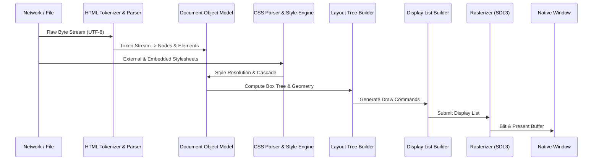

# Browser Rendering Pipeline

This document details the multi-stage pipeline converting raw HTML/CSS into pixels on screen.

---

## Pipeline Overview

---

## Pipeline Stages

### 1. Resource Ingestion & Tokenization
- Input: URL string or local file path.
- Resolves HTTP/HTTPS or local filesystem resources.
- Character decoding: Handles UTF-8 byte streams.
- The `HtmlTokenizer` generates a sequential stream of tokens:
  - `DOCTYPE`
  - `StartTag` (name, attributes)
  - `EndTag` (name)
  - `Character` (text)
  - `Comment`
  - `EndOfFile`

### 2. DOM Construction (Tree Building)
- The `HtmlParser` processes tokens according to an explicit state machine with an open-element stack.
- Creates tree relationships: `Node`, `Element`, `TextNode`, and `Document`.
- Recovers safely from malformed tags and missing closing tags.

### 3. Style Resolution & Computed Styles
- CSS rules from `<style>` tags, external `<link>` stylesheets, and inline `style="..."` attributes are parsed into ASTs.
- `SelectorMatcher` tests elements against selectors (type, class, ID, descendant, child combinators).
- Specificity calculations determine precedence.
- Computed styles are calculated by applying initial values, inherited parent styles, and the CSS cascade.

### 4. Layout Tree Construction & Geometry
- Construct a tree of `LayoutBox` nodes representing renderable elements (elements with `display: none` generate no layout boxes).
- Multi-pass layout calculation:
  - **Pass 1 (Intrinsic Sizing & Widths)**: Determine content widths, margins, borders, and padding based on containing blocks.
  - **Pass 2 (Inline Formatting & Text Wrapping)**: Measure glyphs, break lines into text runs, and establish line box heights.
  - **Pass 3 (Block Positioning & Heights)**: Position boxes vertically in normal flow and compute total container heights.

### 5. Display List Generation
- Traverses the layout tree in stacking order (backgrounds, borders, content/text, foreground child boxes).
- Generates an immutable, serializable list of paint commands:
  - `DrawRect` (solid color fill or stroke)
  - `DrawText` (font, glyph runs, color, position)
  - `DrawImage` (source image, dest rect)
  - `PushClip` / `PopClip` (viewport clipping and overflow boundaries)

### 6. Rasterization & Presentation
- Executes display list commands against the active 2D rendering backend (SDL3 renderer).
- Swaps front and back buffers to present the finished frame to the user.

